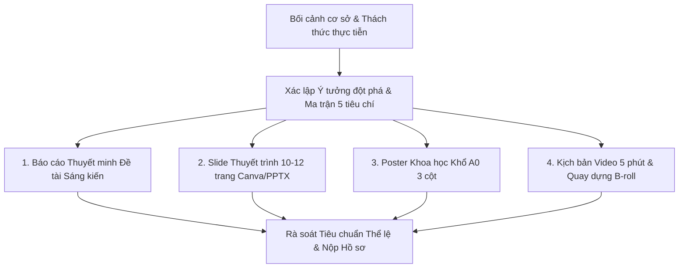

# AI Education Competition Dossier (Bộ Hồ Sơ Sáng Kiến & Thi Đấu AI Giáo Dục)

Kỹ năng này cung cấp toàn bộ phương pháp luận, ma trận tiêu chí, mẫu hồ sơ 3 sản phẩm cấu thành bắt buộc và công cụ sinh tự động phục vụ các cuộc thi sáng tạo khoa học kỹ thuật, giải thưởng chuyển đổi số và AI trong giáo dục.

---

## 1. Khi Nào Kích Hoạt Kỹ Năng Này?

- Khi xây dựng hồ sơ tham dự giải thưởng sáng tạo giáo dục (ví dụ: *Giải thưởng Tiên phong Ứng dụng AI trong Giáo dục Việt Nam* do Bộ GD&ĐT & RMIT tổ chức).
- Khi tối ưu hóa điểm số theo **5 tiêu chí chấm thi chuẩn quốc gia** (100 điểm) theo [Ma Trận 5 Tiêu Chí Đánh Giá](./references/competition_evaluation_matrix.md).
- Khi biên soạn **Slide trình bày 10-12 trang** chuẩn Canva/PowerPoint theo [Khung Slide 12 Trang](./references/slide_deck_12_pages_template.md).
- Khi thiết kế **Poster khoa học A0** bố cục 3 cột theo [Mẫu Poster Khoa Học](./references/scientific_poster_a0_template.md).
- Khi viết **Kịch bản video thuyết minh 5 phút** có phân cảnh và lời bình theo [Kịch Bản Video 5 Phút](./references/video_pitch_5min_script.md).
- Khi lập **Báo cáo thuyết minh sáng kiến kinh nghiệm** theo [Khung Thuyết Minh Sáng Kiến](./references/initiative_report_structure.md).
- Khi cần tự động hóa sinh file poster PowerPoint (.pptx) khổ lớn bằng [build_poster_pptx.py](./scripts/build_poster_pptx.py).

---

## 2. Quy Trình Chuẩn Bị Hồ Sơ Hoàn Hảo

### Bước 1: Khớp nối Ý tưởng với Ma trận 5 Tiêu chí
- Bắt buộc làm nổi bật 2 chỉ số định lượng: **Thời gian tiết kiệm được** (giảm 70-85%) và **Mức độ tương tác của gia đình/người học** (tăng trên 90%).
- Đảm bảo yếu tố "Chi phí 0 đồng" và khả năng nhân rộng trong 30 phút tập huấn.

### Bước 2: Hoàn thiện 3 Sản phẩm Cấu thành Bắt buộc
1. **Slide thuyết trình:** Đảm bảo đủ các slide cốt lõi: Nỗi đau (Pain points) $\rightarrow$ Giải pháp $\rightarrow$ Dữ liệu định lượng $\rightarrow$ Đạo đức AI $\rightarrow$ Khả năng nhân rộng $\rightarrow$ Thông điệp bế mạc.
2. **Poster A0 (24x36 inch):** Sử dụng bố cục 3 cột kinh điển. Có thể chạy lệnh `python scripts/build_poster_pptx.py` để sinh khung poster vector nét tuyệt đối.
3. **Video 5 phút:** Bám sát từng giây theo kịch bản: 35s đầu nêu nỗi đau $\rightarrow$ 75s demo tính năng $\rightarrow$ 60s tác động thực tế $\rightarrow$ 45s đạo đức và nhân rộng $\rightarrow$ 45s kết luận truyền cảm hứng.

### Bước 3: Chuẩn bị Bộ Câu hỏi Phản biện (Q&A)
- Ban giám khảo thường hỏi 3 câu hỏi kinh điển:
  1. *Làm sao đảm bảo AI không đưa ra nhận xét sai lệch về trẻ?* $\rightarrow$ Trả lời: Cơ chế Human-in-the-loop, AI chỉ là thư ký gợi ý, giáo viên là người duyệt cuối cùng.
  2. *Bảo mật dữ liệu trẻ em thế nào?* $\rightarrow$ Trả lời: Tuân thủ Luật Trẻ Em 2016, cơ chế ẩn danh nhân thân, dữ liệu lưu cục bộ trên máy.
  3. *Trường vùng sâu vùng xa không có mạng thì dùng thế nào?* $\rightarrow$ Trả lời: Động cơ heuristic rule-engine chạy offline 100% không tốn một đồng chi phí hay internet.

---

## 3. Tài Liệu Kèm Theo

- [competition_evaluation_matrix.md](./references/competition_evaluation_matrix.md): Phân tích chi tiết 5 tiêu chí chấm điểm và mẹo ghi điểm tuyệt đối.
- [slide_deck_12_pages_template.md](./references/slide_deck_12_pages_template.md): Khung dàn ý 12 slide pitch deck.
- [scientific_poster_a0_template.md](./references/scientific_poster_a0_template.md): Bố cục poster chuẩn triển lãm khoa học.
- [video_pitch_5min_script.md](./references/video_pitch_5min_script.md): Kịch bản quay video 5 phút chi tiết từng giây.
- [initiative_report_structure.md](./references/initiative_report_structure.md): Khung đề tài sáng kiến kinh nghiệm sư phạm.
- [build_poster_pptx.py](./scripts/build_poster_pptx.py): Script Python sinh poster A0 tự động.
