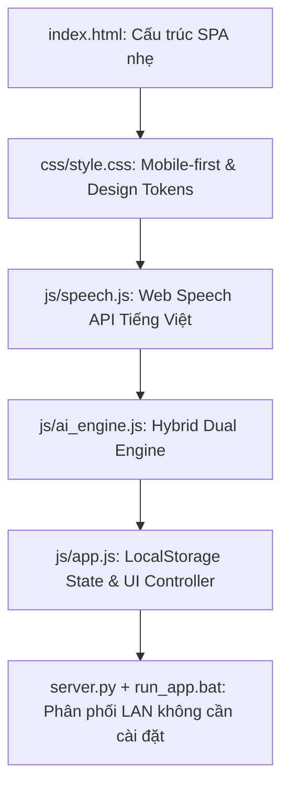

# EdTech Offline-First Web App (Kiến Trúc Web Giáo Dục Nhẹ & Độc Lập)

Kỹ năng này hướng dẫn thiết kế và xây dựng các ứng dụng web giáo dục hoạt động bền bỉ, 0 đồng chi phí máy chủ, tối ưu cho môi trường trường học tại Việt Nam với kết nối Internet không ổn định.

---

## 1. Khi Nào Kích Hoạt Kỹ Năng Này?

- Khi xây dựng ứng dụng web dành cho giáo viên/học sinh không cần setup backend phức tạp (Single Page App bằng HTML, CSS, Vanilla JS).
- Khi triển khai **kiến trúc Hybrid Dual-Engine**: Chạy bằng heuristic rule engine khi offline và gọi Cloud LLM (Gemini) khi online theo [Kiến Trúc Offline](./references/offline_architecture.md).
- Khi tích hợp **Web Speech API tiếng Việt**: Nhập liệu giọng nói mượt mà trên iPhone/Safari, Android/Chrome theo [Hướng Dẫn Web Speech API](./references/speech_api_cross_platform.md).
- Khi thiết kế giao diện **Mobile-first cho giáo viên**: Băng chuyền học sinh vuốt ngang (pill carousel), chip từ khóa nhanh, thanh điều hướng đáy theo [Thiết Kế UX Mobile](./references/mobile_ux_teachers.md).
- Khi đóng gói giải pháp chạy 1-click hoặc chia sẻ trong mạng Wi-Fi LAN trường học qua [server.py](./scripts/server.py) và [run_app.bat](./scripts/run_app.bat).

---

## 2. Quy Trình Xây Dựng Ứng Dụng

### Bước 1: Khởi tạo Bộ khung SPA Tinh Gọn
- Sử dụng Vanilla JavaScript sạch sẽ, không bắt buộc dùng NPM/Webpack cồng kềnh để giáo viên có thể mở chạy trực tiếp file HTML.
- Lưu trữ mọi dữ liệu (học sinh, lịch sử đánh giá, cấu hình) vào `localStorage` của trình duyệt. Cung cấp tính năng Export/Import JSON để sao lưu.

### Bước 2: Tích hợp Nhập liệu Giọng Nói Tiếng Việt
- Kiểm tra tính tương thích `SpeechRecognition` / `webkitSpeechRecognition`.
- Thiết lập `continuous = false` trên điện thoại di động để tránh lỗi ngắt kết nối `aborted` của Safari/Chrome di động.
- Lọc bỏ thông báo lỗi không cần thiết khi người dùng bấm dừng (`aborted`, `no-speech`).

### Bước 3: Triển khai Dual AI Engine
- Mặc định: Chạy Rule-Engine nội bộ với bảng từ khóa tiếng Việt 5 lĩnh vực (tốc độ < 10ms, 0đ chi phí, 100% offline).
- Nâng cao: Nếu người dùng nhập Google Gemini API Key trong bảng Cài đặt, tự động gọi REST API Gemini (`https://generativelanguage.googleapis.com/v1beta/models/...`) với JSON schema đầu ra. Tự động fallback về Rule-Engine nếu mất mạng.

### Bước 4: Đóng gói và Chạy Mạng Nội Bộ (LAN)
- Cung cấp [server.py](./scripts/server.py): Máy chủ mini Python tích hợp tự động dò IP LAN và hiển thị đường link truy cập cho điện thoại.
- Cung cấp [run_app.bat](./scripts/run_app.bat): Script 1-click cho người dùng Windows phổ thông.

---

## 3. Tài Liệu & Script Kèm Theo

- [offline_architecture.md](./references/offline_architecture.md): Sơ đồ luồng dữ liệu, schema LocalStorage, cơ chế fallback tự động.
- [speech_api_cross_platform.md](./references/speech_api_cross_platform.md): Code mẫu Web Speech API và xử lý đặc thù iOS Safari / Android.
- [mobile_ux_teachers.md](./references/mobile_ux_teachers.md): Nguyên lý thiết kế giao diện thao tác 1 tay trong lớp học.
- [server.py](./scripts/server.py): Script máy chủ mini chia sẻ qua Wi-Fi.
- [run_app.bat](./scripts/run_app.bat): File khởi chạy nhanh trên Windows.
