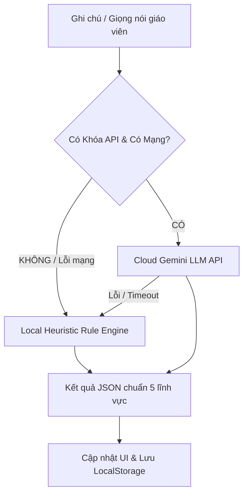

# KIẾN TRÚC ỨNG DỤNG WEB GIÁO DỤC OFFLINE-FIRST & HYBRID DUAL-ENGINE

Ứng dụng phục vụ giáo viên mầm non và phổ thông tại Việt Nam cần đặc biệt chú trọng tính ổn định trong môi trường lớp học: đường truyền mạng chập chờn, giáo viên không có ngân sách trả phí API hàng tháng, và thiết bị cá nhân đa dạng.

---

## 1. MÔ HÌNH KIẾN TRÚC HYBRID DUAL-ENGINE (KÉP)



### Ưu điểm vượt trội:
1. **0 Đồng Chi Phí Vận Hành:** Hoạt động hoàn toàn trơn tru ngay cả khi không có kết nối Internet hoặc không cài đặt bất kỳ API Key nào.
2. **Không phụ thuộc Server Backend:** Ứng dụng là Client-side Single Page App (HTML + CSS + Vanilla JS), có thể chạy bằng cách mở trực tiếp file `index.html` hoặc qua mini server Python nội bộ.
3. **Chuyển mạch thông minh (Automatic Fallback):** Khi cấu hình Gemini API Key nhưng bị lỗi mạng (hoặc hết quota), hệ thống tự động fallback về Rule Engine nội bộ trong 10ms mà không làm gián đoạn công việc của giáo viên.

---

## 2. QUẢN TRỊ DỮ LIỆU BẰNG LOCALSTORAGE

### Schema Cấu Trúc Dữ Liệu Khuyến Nghị:

```javascript
// 1. Danh sách học sinh trong lớp
const students = [
  {
    id: "std_01",
    code: "PSB-01",
    name: "Nguyễn Tuấn Kiệt",
    nickName: "Bé Bon",
    gender: "male",
    birthDate: "2020-03-15",
    avatar: "assets/bon.jpg", // hoặc link DiceBear svg
    classId: "la1"
  }
];

// 2. Nhật ký đánh giá theo ngày/học sinh
const logs = {
  "2026-10-16_std_01": {
    studentId: "std_01",
    date: "2026-10-16",
    rawNote: "Ăn nhanh hết suất, hào hứng xếp khối gỗ lego...",
    ratings: { theChat: 5, nhanThuc: 5, ngonNgu: 4, tinhCamXH: 5, thamMy: 4 },
    theChat: "...",
    nhanThuc: "...",
    ngonNgu: "...",
    tinhCamXH: "...",
    thamMy: "...",
    parentMessage: "...",
    homeTip: "...",
    updatedAt: "2026-10-16T17:30:00Z"
  }
};

// 3. Cài đặt hệ thống
const appSettings = {
  isMasked: false, // Chế độ mặt nạ bảo mật Luật Trẻ Em
  activeTheme: "theme-rainbow",
  geminiKey: "",
  geminiModel: "gemini-2.5-flash"
};
```

---

## 3. CƠ CHẾ SAO LƯU & PHỤC HỒI (BACKUP & RESTORE)

- **Xuất dữ liệu (Export JSON):** Cho phép giáo viên tải toàn bộ danh sách lớp và lịch sử đánh giá về máy dưới dạng 1 file `kid_connect_backup_2026.json`.
- **Nhập dữ liệu (Import JSON):** Hỗ trợ đổi máy tính, khôi phục dữ liệu hoặc chuyển giao giữa các cô giáo cùng phụ trách lớp chỉ với 1 thao tác chọn file.
