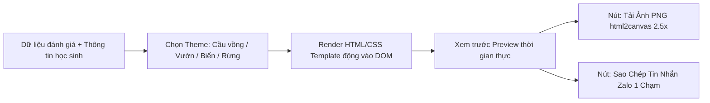

# Infographic Card Generator (Trình Tạo Thẻ Báo Cáo Sư Phạm Đa Chủ Đề)

Kỹ năng này chuyên sâu về thiết kế trực quan, tự động hóa kết xuất thẻ đánh giá học sinh/trẻ em dạng Infographic rực rỡ phong cách Canva, xuất file ảnh PNG chất lượng cao và định dạng tin nhắn chia sẻ qua Zalo cho phụ huynh.

---

## 1. Khi Nào Kích Hoạt Kỹ Năng Này?

- Khi thiết kế hoặc tùy biến giao diện thẻ học tập, nhật ký ngày/tuần, thiệp khen thưởng cho trẻ em.
- Khi cần áp dụng **4 chủ đề màu sắc mầm non**: Cầu vồng, Khu vườn, Đại dương, Rừng cổ tích theo [Hệ Thống Design Tokens](./references/theme_design_tokens.css).
- Khi lập trình tính năng **chụp ảnh DOM sang PNG độ nét cao** chuẩn Retina bằng thư viện `html2canvas` theo [Quy Trình DOM-to-Image](./references/dom_to_image_pipeline.md).
- Khi tạo cấu trúc **tin nhắn Zalo 1 chạm** gửi phụ huynh kèm emoji, điểm số 5 lĩnh vực và gợi ý tương tác tại nhà theo [Mẫu Tin Nhắn Zalo](./references/zalo_parent_message_templates.md).
- Khi cần code mẫu triển khai nhanh bộ tạo thẻ JavaScript [card_generator_sample.js](./examples/card_generator_sample.js).

---

## 2. Quy Trình Tạo Thẻ & Xuất Bản

### Bước 1: Áp dụng Tokens & Theme
- Thiết lập biến CSS `--card-bg-gradient`, `--card-primary`, `--star-filled-color` cho từng chủ đề.
- Sử dụng các icon trang trí góc (🌸, ⭐, 🎈, 🌈) để tạo cảm giác gần gũi với lứa tuổi mầm non/tiểu học.

### Bước 2: Hiển thị Thẻ Đánh Giá Trực Quan
- Dùng `card_generator_sample.js` để render các hộp thông tin 5 lĩnh vực, thanh sao ⭐ (1-5 sao), avatar tròn và huy hiệu trường lớp.
- Hỗ trợ chế độ bảo mật: Nếu bật chế độ ẩn danh nhân thân, tên thật chuyển thành biệt danh + mã số, avatar chuyển thành Robot/DiceBear.

### Bước 3: Xuất Ảnh & Chia Sẻ
- Kích hoạt hàm `exportCardToPNG()`: Tự động nhân bản DOM với scale 2.5x để đảm bảo ảnh chữ sắc nét, không bị vỡ hạt trên điện thoại.
- Kích hoạt `copyZaloMessageToClipboard()`: Sao chép toàn bộ nội dung tóm tắt để giáo viên chỉ việc bấm Dán (Paste) vào Zalo lớp.

---

## 3. Tài Liệu Kèm Theo

- [theme_design_tokens.css](./references/theme_design_tokens.css): Khung màu, gradient, biến CSS cho 4 chủ đề thiết kế.
- [dom_to_image_pipeline.md](./references/dom_to_image_pipeline.md): Hướng dẫn cấu hình `html2canvas` tránh lỗi font tiếng Việt và co giãn di động.
- [zalo_parent_message_templates.md](./references/zalo_parent_message_templates.md): Mẫu văn bản Zalo chuẩn đẹp kèm logic sao chép clipboard an toàn.
- [card_generator_sample.js](./examples/card_generator_sample.js): Lớp điều khiển JavaScript hoàn chỉnh cho thẻ đánh giá.
