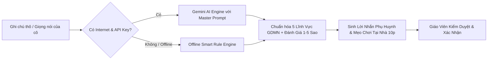

# Kindergarten Pedagogical AI (Trợ Lý Sư Phạm Mầm Non Việt Nam)

Kỹ năng này chuyên sâu về nghiệp vụ sư phạm mầm non Việt Nam, quy chuẩn đánh giá trẻ theo 5 lĩnh vực phát triển của Bộ Giáo dục và Đào tạo, chuyển đổi ghi chú thô/giọng nói thành nhận xét sư phạm nhân văn và tạo lời khuyên gắn kết gia đình.

---

## 1. Khi Nào Kích Hoạt Kỹ Năng Này?

- Khi xây dựng tính năng đánh giá sự phát triển của trẻ mầm non (nhật ký ngày, đánh giá tuần/tháng/kỳ).
- Khi thiết kế prompt hoặc rule-engine đối chiếu hành vi thực tế vào **5 lĩnh vực GDMN**: *Thể chất, Nhận thức, Ngôn ngữ, Tình cảm - Kỹ năng xã hội, Thẩm mỹ* theo [Khung Đánh Giá 5 Lĩnh Vực](./references/moet_5_domains_rubric.md).
- Khi tạo tin nhắn tương tác gửi phụ huynh (Home Connection) và gợi ý hoạt động 10-15 phút tại nhà.
- Khi cần triển khai quy tắc đạo đức AI và bảo mật thông tin trẻ em theo [Quy Tắc Đạo Đức Trẻ Em](./references/child_data_ethics.md).

---

## 2. Quy Trình Phân Tích Sư Phạm Chuẩn

### Bước 1: Tiếp nhận dữ liệu đầu vào
- Ghi chú 20-40 từ (ví dụ: *"Bé ăn nhanh, xếp lego máy bay rất khéo, chiều chạy nhảy hăng say nhưng hơi kén rau cải"*).
- Dữ liệu học sinh: Tên/Biệt danh, Mã ẩn danh, Nhóm tuổi (Nhà trẻ, 3-4, 4-5, 5-6 tuổi).

### Bước 2: Phân tích & Chuẩn hóa sư phạm
- Nếu có mạng: Dùng [Hệ thống Gemini Prompts](./references/gemini_prompts_preschool.md) để trả về JSON chuẩn gồm `ratings`, 5 lĩnh vực, `parentMessage`, `homeTip`.
- Nếu offline: Dùng thuật toán heuristic từ khóa mẫu trong [rule_engine_vi.js](./examples/rule_engine_vi.js).

### Bước 3: Đảm bảo Đạo đức & Quyền riêng tư
- Bắt buộc kiểm duyệt: Quyền quyết định cuối cùng luôn thuộc về giáo viên (Human-in-the-Loop).
- Kích hoạt chế độ ẩn danh nhân thân (Anonymization Masking) khi xuất bản hoặc demo ra ngoài.

---

## 3. Tài Liệu Tham Khảo Kèm Theo

- [moet_5_domains_rubric.md](./references/moet_5_domains_rubric.md): Bảng tiêu chí chi tiết từng độ tuổi và 5 lĩnh vực theo Thông tư 51/2020/TT-BGDĐT.
- [gemini_prompts_preschool.md](./references/gemini_prompts_preschool.md): Bộ Prompt Master, System Instruction, JSON Output Schema và Few-shot Examples.
- [child_data_ethics.md](./references/child_data_ethics.md): Hướng dẫn tuân thủ Luật Trẻ em 2016 và UNESCO AI Ethics.
- [rule_engine_vi.js](./examples/rule_engine_vi.js): Code JavaScript phân tích từ khóa tiếng Việt offline chạy tức thì không tốn chi phí.
